<p align="center">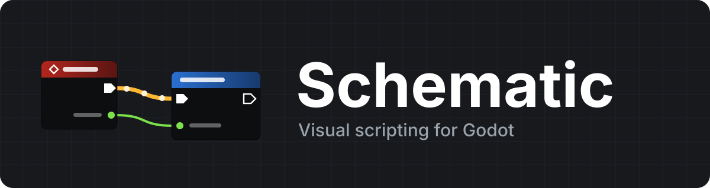</p>

**Visual scripting for Godot 4. You wire nodes; it writes the GDScript you would have written.**

[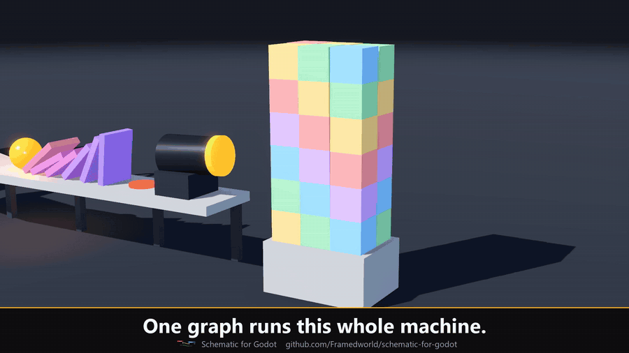](docs/video/schematic_machine.mp4)

*One schematic runs this whole machine: it is `demo/machine`. [Watch the video at full quality](docs/video/schematic_machine.mp4),
or [the one-minute tour of everything](docs/video/schematic_tour.mp4).*

[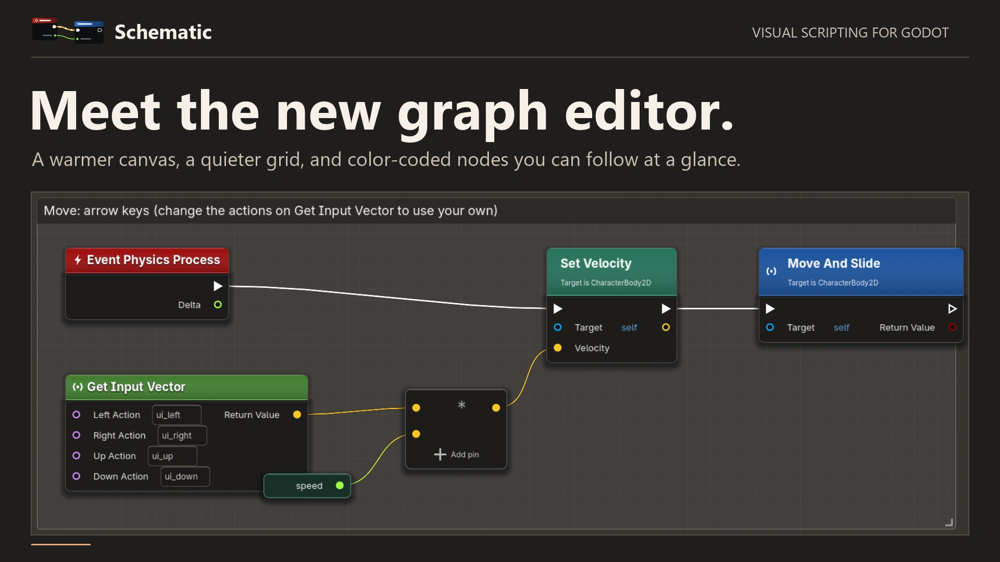](docs/images/store/gallery/01_editor.webp)

Schematic is an editor plugin for building game logic as graphs of nodes and wires. There is no custom engine build, no runtime library and no new file
type: a Schematic is an ordinary `.gd` script, so it attaches to nodes, exports variables to the Inspector,
registers a `class_name`, and is called from hand-written code like any other script.

Needs Godot 4.6 or later. Tested on stock Godot 4.6 and 4.7.1 and on a 4.8 development build; older versions have
not been tried, and on 4.3 the plugin does not load.

## A Schematic is a GDScript file

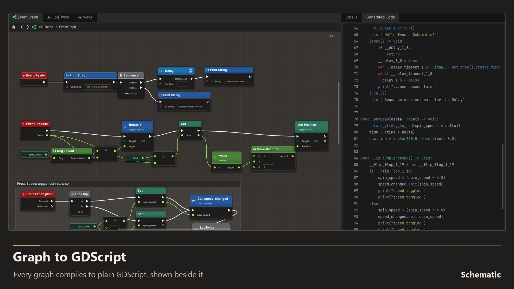

The graph compiles to plain, readable GDScript, and the graph itself is kept in the same file as a comment
block. What runs in your game is the code on the right: no interpreter and no per-node cost. Turn the plugin
off and your Schematics still run.

The graph is what Schematic saves from, so a change made to the code by hand (or by a pull, or another tool) is
not in the graph. Schematic notices: a bar above the graph says the file changed outside it, shows the differing
lines, and nothing writes over the file until you choose. **Re-import Code** brings the change into the graph:
only the functions and events that changed are rebuilt, everything else stays as it was down to where each node
sits, and it is one step you can undo. Inside a function that did change, the nodes of the lines you did not touch
stay where they are too, with their breakpoints; only the lines you edited get new nodes, placed beside them. A preview says first what will be rebuilt, added or removed. An edit that
cannot be brought in (a change to a line Schematic writes for its own use, code that does not parse) is refused
with the reason and the line, and nothing changes. Comments written by hand are kept.

## Find any node by typing

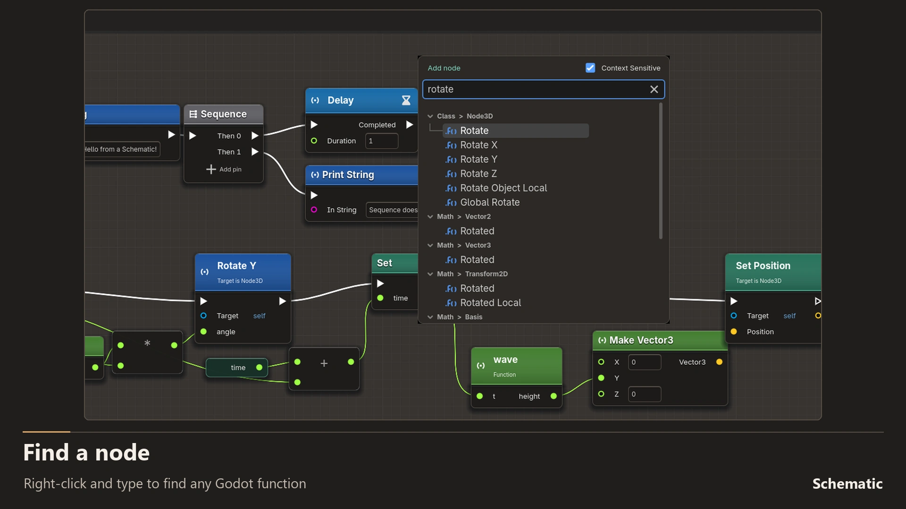

Right-click, or drag off a pin, and type. The menu lists every function of every Godot class, your own
functions, variables, macros and libraries, filtered to what fits the pin you dragged from. Unreal names work
too: typing `BeginPlay` finds Event Ready.

## Start from something that works

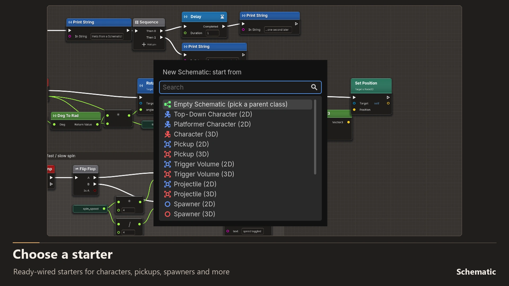

New Schematic offers ready-wired starters beside Empty: 2D and 3D characters, pickups, trigger volumes,
projectiles, spawners, a health component, a game state and a score HUD, plus function libraries, macro
libraries, data assets and interfaces. `demo/arcade` is a small game made from five of them, unchanged.


## Debug on the graph

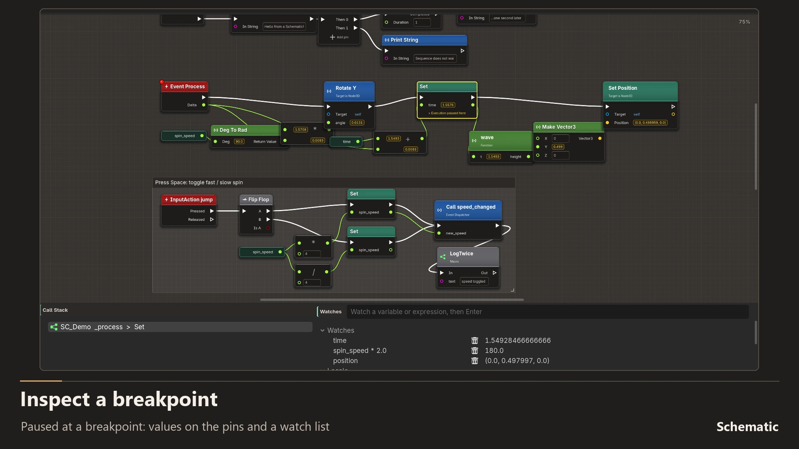

Put a breakpoint on a node with F9. When the game stops there, every wired pin of that function shows its
value, and Step Into, Step Over and Step Out move one node at a time. Watch any variable or expression, or
right-click a node and watch one of its pins.

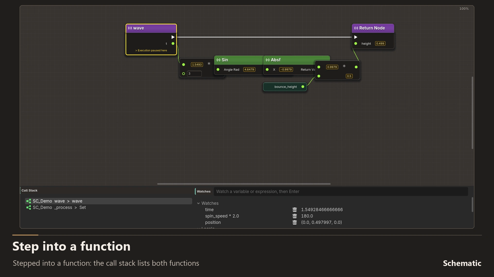

The Call Stack lists the functions that are running and the node each is at. Click one to see its graph and its
values.

## Watch it run

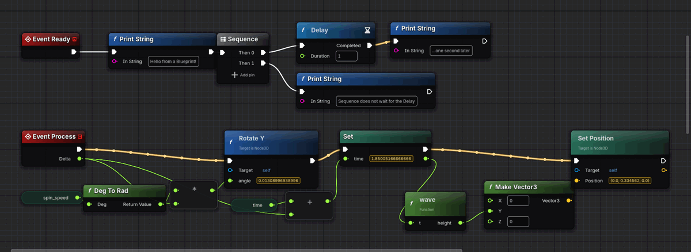

Turn on Show Flow and Values and play: the wires the game follows light up with moving dots, and each pin
shows the last value it received. This is opt-in per Schematic, because it adds trace calls to the generated
code; with it off, nothing is added.

## Interfaces

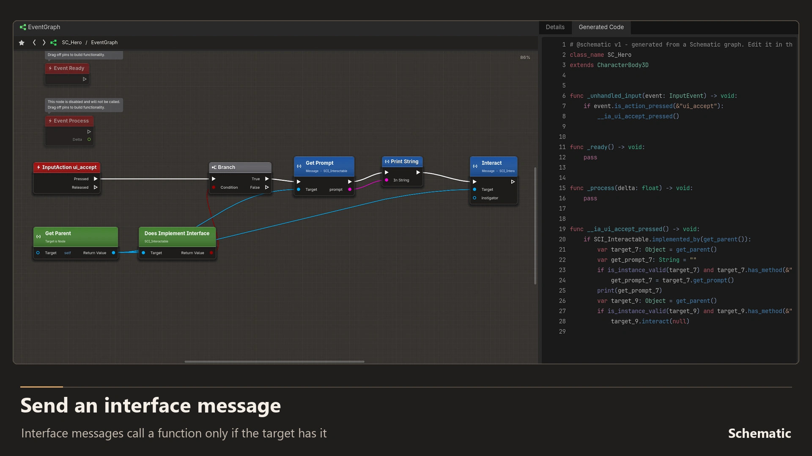

A Schematic Interface is a list of functions that different Schematics agree to have. A Message node calls one
on any object and does nothing if the object does not have it, so a player can Interact with whatever it is
looking at without knowing its class. It compiles to the `has_method` check you would write yourself.

## Bring the scripts you already have

[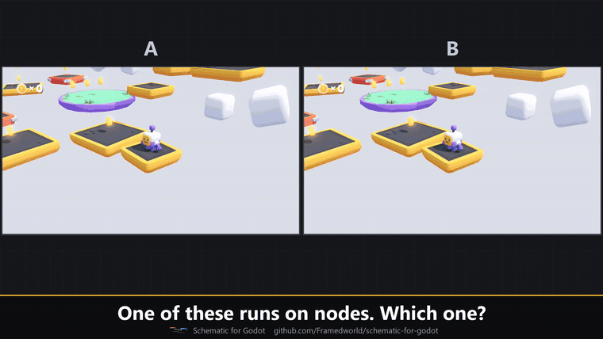](docs/video/schematic_convert.mp4)

*Kenney's platformer kit, as written and after conversion. [Watch the video at full quality](docs/video/schematic_convert.mp4).*

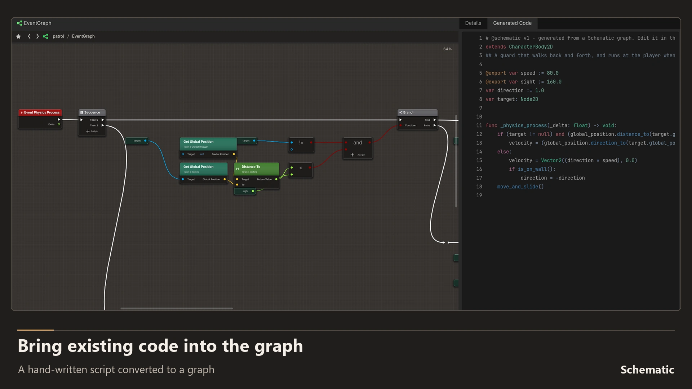

Right-click a `.gd` file and pick Convert to Schematic, or convert a whole project from the command line. The
original is kept beside it, and the converted script is declared the way the source was: what was untyped stays
untyped, `:=` stays `:=`, signatures, signals, exports and constants are the same, so every other script sees the
script it saw before.

Kenney's 3D platformer starter kit converts with all 110 lines as nodes. Rendered with the same input, the original
and the converted game are the same in all 560 frames, to the pixel. The converter is also run over every script of
14 projects (5,284 scripts, 694,792 lines of statements, 98.1% of them nodes): wherever the original
loads, the converted script loads too and offers the same functions, variables, signals and constants.

## Timelines and data tables

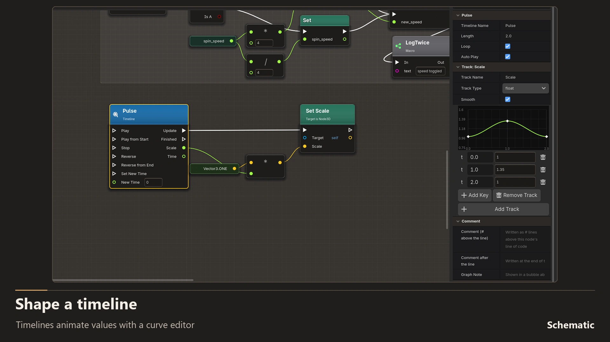

Timelines animate values over time with a curve editor in the Details panel. Data Assets are structures of
fields, and Data Tables are rows of them, with CSV import and export.

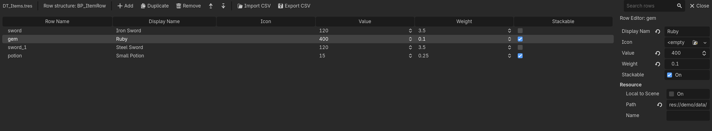

## Schematics stand out in your project

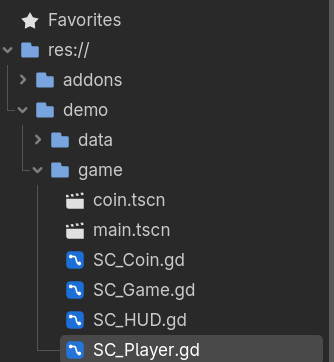

Schematic files have their own icon in the FileSystem dock, and double-clicking one opens the graph instead of
the script editor.

## What it does not do

If you come from Unreal, the graphs will feel familiar; `PARITY.md` lists every Blueprint feature there and
where this plugin stands on it. The main gaps are
in-graph animation pose editing (Godot's AnimationTree covers that) and interface-typed pins (GDScript has no
interfaces). The limits of the debugger are listed under Debugging below.

The pictures on this page are taken from the running editor by `tests/shot_readme.gd`, and the animation by
`tests/shot_readme_gif.gd` and `tools/make_gif.py`.

## Licence

Schematic is licensed under the [Apache License 2.0](LICENSE.md). You may use, modify and redistribute the plugin, including in commercial projects, under that licence. You retain ownership of your own game logic and generated scripts. The bundled Godot API reference data carries its [upstream notice](addons/schematic/NOTICE.txt).

## Installing it in your own project

1. Copy the `addons/schematic` folder into your project's `addons` folder (make `addons` if there is none).
2. Open the project, go to Project > Project Settings > Plugins and tick Enable beside Schematics.
3. A **Schematic** tab appears next to 2D / 3D / Script. Nothing else is needed: there is no autoload, no export
   setting and no engine build.

To update, replace the `addons/schematic` folder with the new one, then open each Schematic you want to debug
and save it once (breakpoints follow the line numbers of the saved script).

To remove it, disable the plugin and delete the folder. Your Schematics stay ordinary `.gd` scripts that run
without it; only `addons/schematic/runtime/data_table.gd` is needed at run time, and only if you use Data Tables.

This repository is also a Godot project you can open as it is to try the demos and run the tests. Some tests
named in this file (`tests/kits`, `tests/rewrite`, `tests/ports`, `tests/engine`) and the `ports` folder need
other projects and are not in the repository.

## Using it

1. Open this folder as a project (the plugin is already enabled), or copy `addons/schematic` into your project
   and enable it in Project Settings > Plugins.
2. A **Schematic** tab appears next to 2D / 3D / Script.
3. Create one: **New Schematic** in the toolbar, FileSystem right-click > Create New > **Schematic Class...**,
   or Scene tree right-click > **Attach New Schematic...**. Pick a starter (or Empty and a parent class), pick a file name.
   Starters are ready-wired graphs: Top-Down / Platformer / 3D Character, Pickup, Trigger Volume, Projectile, Spawner,
   Health Component, Game State and Score HUD. They work alone and together (characters join the `player` group,
   the Game State joins `game_state`); pickups and triggers need a CollisionShape child, the Spawner a scene.
4. Double-clicking a Schematic `.gd` in the FileSystem opens it in the graph editor.
5. `demo/demo.tscn` + `demo/SC_Demo.gd` is a working example (press Space while it runs).
6. `demo/arcade/arcade.tscn` is the coin-collecting game from the video: five starters (character, pickup, spawner,
   game state, score HUD) and two scenes, with no script written by hand. Arrow keys to move.
7. `demo/game/main.tscn` is a smaller game built node by node in a test (player, coins, HUD): arrow keys to move.
8. `demo/machine/machine.tscn` is a chain reaction in 3D: a marble, a trapdoor, a launcher, dominoes, and a cannon
   that knocks a tower down. One schematic on the scene's root runs all of it, one frame of the graph per part.
   Open `SC_Machine.gd`, turn on Show Flow and Values, and play the scene to watch each part light up as it runs
   ([video](docs/video/schematic_machine.mp4)).

### Editor

| Unreal | Here |
|---|---|
| Right-click graph / Tab | Action menu (search, categories, Context Sensitive toggle) |
| Drag off a pin | Context-filtered action menu; new node is auto-wired |
| My Blueprint | **Members** lists graphs, Functions (+ Override), Variables, Event Dispatchers, Local Variables |
| Components | **Scene nodes** lists the nodes under the schematic's node: drag in for a reference, right-click for signal events |
| Details | Variable / function / node / class settings |
| Compile | Compile button, F7, or Ctrl+S (also runs before Play). Errors appear on nodes and in Compiler Results |
| B / S / D / F / G / O / N / P + click | Branch / Sequence / Delay / ForEach / Gate / DoOnce / IsValid / Print |
| C | Comment box around selection |
| F9 | Toggle a breakpoint on the selected node; the game pauses on that node and the graph jumps to it |
| F10 / F11 / Alt+F11 while paused | Step Over / Step Into / Step Out, one node at a time |
| Ctrl-drag / Alt-drag variable | Get / Set |
| Eye beside a variable | Toggles Instance Editable |
| Typing an Unreal name (BeginPlay, GetActorLocation...) | Finds the Godot node; the row shows the Unreal name it matched |
| Watch values | Class Settings > Show Flow and Values: wired input pins show their last value while the game runs |
| Animated wires | With Show Flow and Values on, dots run along each exec wire the game follows; a node step at a breakpoint animates the wire it took |
| Drag from Scene dock or FileSystem | Node reference / preloaded resource |

The **Generated Code** tab shows the GDScript live, and the two sides are linked. Select nodes and their lines are
highlighted: strongly for the lines a node wrote, softly for the lines it only feeds a value into. Click a line and
the node that wrote it is selected and centred, in whichever function it is; the nodes feeding that line get an
outline. A line no node wrote (a declaration, a helper) says what it is under the code. While the game is stopped
at a breakpoint the line it stopped on is marked and followed step by step, and the tab shows the code the game is
running even if the graph has changed since. A click in the code's gutter sets a breakpoint on the node that wrote
that line.

### Semantics that match Blueprints

- Pure nodes (no exec pins) are re-evaluated by each consumer; impure outputs are cached in locals.
- `Sequence` does not wait for latent work started by an earlier pin.
- `Delay` ignores re-triggers while pending; `Retriggerable Delay` restarts.
- `Do Once`, `Do N`, `Flip Flop`, `Gate` keep state per instance and per node.
- Latent nodes are rejected inside function graphs.
- **Data**: a Schematic of type **Data Asset** (New Schematic > Data Asset, or Class Settings > Schematic Type) is a
  structure of fields, like an Unreal struct; graphs get Make and Break nodes for it. A **Data Table** (FileSystem >
  Create New > Data Table, or Project > Tools > New Data Table) is a file of named rows of one structure. Double-click it
  to edit it as a grid, with the selected row's full editor beside it; CSV import and export are in its toolbar. In a
  graph, drag the table file in to get a **Get Data Table Row** node, or use the Data Table nodes (Get Rows, Find Rows...).
  `demo/data` has a sample. Tables need `addons/schematic/runtime/data_table.gd` in the exported game.
- **Convert an existing script**: right-click a `.gd` in the FileSystem dock (or a node with a script in the Scene dock)
  > **Convert to Schematic...**. Statements become nodes and the result behaves like the source. The original is kept
  as `<name>.gd.orig`. A whole project converts with
  `godot --headless --path <project> res://addons/schematic/tools/convert_project.tscn -- --only=scripts,scenes`
  (run it, import, run it again; `--only` keeps it to the folders named, so a project's own tests and tools stay scripts).
  What GDScript can say and a plain Schematic could not is covered by node forms rather than code blocks:
  - a call that must run where its value is read (`a and f()`, `g(x, f())`, `f() if c else h()`) is a call node marked
    **runs in place**: it has no exec pins and is written into the line that reads it;
  - `await f()` is the call node marked **waits for it**; `await signal` is **Wait For**; the usual timer wait is **Wait**.
    A function that waits is marked as one, and its Sequence and loop nodes are the kind that wait for each step;
  - a value whose type is not known (an untyped variable, a helper script loaded by path) is read, set and called
    **by name** (*Get / Set / Call (by name)*), which is what the script does;
  - `match` is a **Switch**; `if x.has_method(m): x.call(m, ...)` is **Call If Present**; `is` / `as` on built-in types are
    **Is / As** nodes; `v.x = ...` on a vector held in a variable or property is a Set node for that member;
  - a lambda becomes a function of the schematic, with what it captured bound to the reference; handed to `connect`
    (or with optional parameters and captured values) it is a **Lambda** node, which makes a separate Callable each time.
    In the generated code it is written back as the lambda it was, in the place it stood, so calling it costs what it
    cost before;
  - comments are kept where they were written: above a statement, at the end of a line, at the end of a block,
    above a function or a variable. They sit on the node as a bubble you can edit in the Details panel, and are
    written back into the code; blank lines inside a function are kept too;
  - an event keeps the parameter names the script gave it (`func _process(dt)` stays `dt`, on the pin and in the code);
    its locals and every loop variable keep their names too (`var speed`, `for y in range(h)`), and get a suffix or
    a number only where two of them would otherwise clash;
  - a statement that is only an expression still runs what is in it: `a() and b()` is a Branch, `x() if c else y()` is
    a Branch with a call on each side;
  - a `match` arm that binds names (`[var a, var b]`, `{"hp": var hp}`, `var x when x > 3`) is a Switch case; the
    names it binds are read through small nodes that carry the name;
  - `len`, `range` as a value, `assert`, `ord`, `char`, `is_instance_of`, `type_exists` and `print_stack` have nodes
    of their own; a function of the script named like one of GDScript's (`log`, `range`) is called through `self`, as
    GDScript requires;
  - a parameter read far from where the event or function begins gets a small node with its name beside the reader,
    instead of a wire across the graph;
  - an execution wire that drops to a lower row (what follows an `if`, an `else`, a `match` case, the end of a loop)
    goes through a reroute node, so it runs down and then along the row instead of across the nodes in between.

  What still stays as a GDScript node: a loop over a float or a vector, a new value given to a loop variable, a call
  to `_input()` or another event by hand, a call that passes extra arguments to a `...rest` parameter, and lines the
  parser does not understand. A script that extends another by its path (`extends "res://base.gd"`) keeps doing so.
  Windows line endings are kept (a string that runs over several lines holds its file's line breaks).
- **Reuse**: groups of nodes that repeat, inside one Schematic or across a project's Schematics, become macros that
  every place then uses. `convert_project.tscn` does this after converting (`--no-reuse` skips it), and
  `godot --headless --path <project> res://addons/schematic/tools/reuse_project.tscn -- --only=scripts,scenes`
  does it for Schematics that exist already (`--dry` only reports). Macros used by more than one file go to a macro
  library, `res://shared_macros.gd` (`--library=` names another place); the rest stay in the file that uses them.
  What differs between the places (a number, a text, a variable, a value from outside) is an input pin; a local
  variable the group sets is a local of the macro, and each use says which of its own locals that is. A macro is
  expanded where it is used, so the generated scripts are unchanged and nothing is added at run time. The tool
  checks exactly that: a Schematic is only changed when the script generated from it afterwards is the script
  generated before (a loop variable that had to be numbered may get another number); otherwise it is put back.
  Never grouped: Return, Break, Continue, GDScript nodes and nodes that keep state (Do Once, Delay...). A group has
  to save at least 8 nodes over all its uses, with at most 6 input pins and 2 value outputs. A file at the
  library's path that reuse did not make is never written over. Running the tool again is safe; it may find a few
  more groups, since a macro node can itself be part of a group.
- Libraries: set Class Settings > Schematic Type to **Function Library** (every function becomes static and shows up in
  every schematic under Function Libraries; needs a Class Name) or **Macro Library** (its macros show up in every
  schematic under Macros). Both are also offered as starters by New Schematic.
- Macros (Members > MACROS) are expanded into each graph that uses them: several exec inputs/outputs,
  latent nodes allowed, and every use keeps its own Do Once / Flip Flop / Delay state.
- Timelines (action menu > Add Timeline...) have float / Vector2 / Vector3 / Color tracks edited in Details,
  with Play, Play from Start, Stop, Reverse, Reverse from End and Set New Time inputs, Update and Finished outputs,
  looping and auto play.
- Event Dispatchers are real Godot signals; custom events and functions are real methods.

## Layout

- `addons/schematic/core` - types, document model, node registry (reflection-driven), compiler
- `addons/schematic/editor` - main screen, graph canvas, node widgets, palette
- `addons/schematic/data/api.json` - built-in types / utility functions / doc blurbs, generated by `tools/gen_api.py`
  from `godot --dump-extension-api-with-docs`
- `addons/schematic/core/sc_starters.gd` - the starter schematics offered by New Schematic
- `tests/test_compile.gd` - headless compiler tests; `tests/test_starters.gd` - builds every starter and plays them; `tests/shot.gd` - in-editor self-test with screenshots

```
godot --headless --path . --script res://tests/test_compile.gd
godot --path . --editor -- --sc-selftest=res://tests/shot.gd        # also shot_input, shot_panels, shot_look, shot_alias, shot_macros, shot_tieins, shot_debug, shot_debugger, shot_interfaces, shot_collapse, shot_starters, shot_libs, shot_import, shot_data, shot_reuse, shot_flow_reroute, shot_edit_converted, shot_kit_missing, shot_public_kit, shot_kit_problems, shot_code_link, shot_code_link_run, shot_drift, shot_reimport, shot_node_comments
godot --headless --path . --script res://tests/test_data.gd
godot --headless --path . --script res://tests/test_import.gd
godot --headless --path . --script res://tests/test_convert.gd     # the converter's torture test: tests/convert/*.gd run as written and converted
godot --headless --path . --script res://tests/test_fixed_point.gd # converting the generated code again must reproduce both the text and the graph
godot --headless --path . --script res://tests/test_code_link.gd   # every generated line to its nodes, and back
godot --headless --path . --script res://tests/test_kit_missing.gd # a node whose addon is missing keeps its wires
godot --headless --path . --script res://tests/test_public_kit.gd  # nodes shipped by another addon (tests/fake_kit)
godot --headless --path . --script res://tests/test_drift.gd       # telling a hand-edited file from the one Schematic wrote
godot --headless --path . --script res://tests/test_sync.gd        # a script split into its blocks: the user's code and the compiler's
godot --headless --path . --script res://tests/test_reimport.gd    # a hand-edited file brought back into its graph, function by function
godot --headless --path . --script res://tests/stress_convert.gd -- <folder of scripts>   # converts any scripts and checks the result (reads only)
godot --headless --path . --script res://tests/test_libraries.gd
godot --headless --path . --script res://tests/test_interfaces.gd
godot --headless --path . --script res://tests/test_reuse.gd
godot --headless --path . --script res://tests/test_starters.gd
godot --headless --path . --script res://tests/test_game.gd
godot --headless --path . --script res://tests/make_arcade.gd      # rebuilds demo/arcade from the starters
godot --headless --path . --script res://tests/make_machine.gd     # rebuilds demo/machine
godot --headless --fixed-fps 60 --path . --script res://tests/test_machine.gd   # runs the chain reaction to the end
```

## Extending

**Make nodes for your addon:** ship one file, `schematic_kit.gd`, at the root of your addon folder and its nodes
appear in Schematic's action menu, with no dependency on Schematic and no registration call. The format, a worked
example and what users see when your addon is missing are in [docs/KITS.md](docs/KITS.md). A node whose addon is not
installed is shown as a red placeholder that keeps every wire, and is a normal node again when the addon is back.

From a plugin or tool script of your own project you can also register a node directly:

```gdscript
const BPRegistry := preload("res://addons/schematic/core/sc_registry.gd")
BPRegistry.register_template("heal", {"title": "Heal", "cat": "My Game",
	"ins": [["target", "Target", "Node", "self"], ["amount", "Amount", "float", "10.0"]],
	"outs": [], "lines": ["{target}.health += {amount}"]})
```

Feature-by-feature status against Unreal is in PARITY.md; what would need engine changes is in ENGINE_CASE.md.

## Interfaces

A Schematic Interface is a list of functions that different schematics agree to have, so one schematic can
talk to another without knowing its class (a player that calls Interact on whatever it is looking at).

1. New Schematic Class > Schematic Interface. Add functions in Members and give each its inputs and outputs
   in the Details panel. An interface has no code.
2. In a schematic that should answer, Class Settings > Interfaces > Add Interface. The interface's functions
   are added to Members to fill in. One you delete is written as an empty function that returns default
   values; one whose inputs or outputs differ from the interface is a compile error. A custom event with the
   function's name also counts.
3. To call, use the nodes under Interface Messages in the action menu. A Message node calls the function if the
   target has it and does nothing otherwise (its outputs then keep their default values). Does Implement
   Interface is true when the target has every function of the interface.

A Message node compiles to what a person would write:

    if is_instance_valid(target) and target.has_method(&"interact"):
        target.interact(self)

GDScript has no interfaces, so "implements" means "has those functions". A hand-written script that defines
them counts as implementing the interface, and there is no interface type for pins or variables.

## Debugging

Set a breakpoint on a node with F9. When the game stops there, the Schematic editor shows:

- the node it stopped at, and on every wired input pin of that function the value it has now;
- Resume, Step Into, Step Over and Step Out in the toolbar. They move one node at a time: generated lines that
  belong to the same node, or to no node, are passed over;
- a Call Stack list (click a function to see its graph and values; double-click a hand-written script to open it);
- a Watches list: type a variable or an expression, or right-click a node and pick Watch This Value for one of
  its pins. The locals and variables of the selected function are listed under it.

How it works: nothing is added to the generated scripts. The first time the game stops, the editor asks it
(through Godot's own Evaluate request) to load `addons/schematic/runtime/sc_debug_probe.gd`, which then answers
the editor's questions over the debugger connection. Expressions are worked out with calls that cannot change
anything, so a watch such as `queue_free()` shows no value instead of running.

Schematic files have their own icon in the FileSystem dock. The plugin sets it on the dock's rows; nothing is
written into the scripts for it.

Limits:

- Each stop leaves one line in the Evaluator tab of Godot's Debugger panel (that request is the only way to
  learn which object a function is running on). The tab is cleared at the next run.
- The probe is loaded at the first stop inside a function that has a `self`. If the first stop of a run is in a
  static function (a function library), the lists stay empty until a later stop; stepping still works.
- A pin whose value needs GDScript that Godot's Expression class cannot read (`a if c else b`, `as`, `$Node`,
  a call that could change something) shows no value.
- The step buttons in Godot's own Debugger panel still step generated lines.
- Step Out from a function the engine calls itself (`_process`, `_ready`) lets the game run on; in one test on a
  large converted project it did not stop again. Use Step Over there.

## Not done yet

See PARITY.md for the full list
